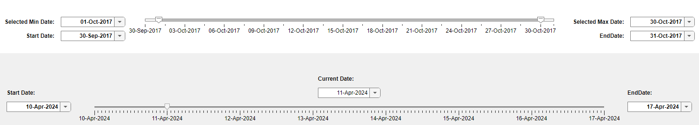

# Datetime Slider UI Components

[](https://matlab.mathworks.com/open/github/v1?repo=mathworks/datetimeslider-uicomponents)
[](https://www.mathworks.com/matlabcentral/fileexchange/180805-datetime-sliders)

Select a date or a date interval in a MATLAB&reg; app with reusable App Designer
components. `DatetimeSlider` provides a single slider thumb, while
`DatetimeRangeSlider` provides two thumbs for selecting an interval. Both
include date pickers for the selection and the overall limits.

Use the components to move a marker through daily observations, highlight a
period in a time series, or choose a date range for further analysis. Read the
selection as MATLAB `datetime` values and connect it to your app through
callbacks.



## Features

- **Single-date and interval selection**: Choose the control that matches your
  app's workflow.
- **Editable limits**: Set the overall date range in code or with the limit
  date pickers.
- **Datetime properties**: Work with `datetime` values directly in app code.
- **Date labels**: Customize the slider's tick-label format.
- **App Designer integration**: Drag the components onto an app or create them
  programmatically in a `uifigure`.
- **Examples included**: Explore date markers, highlighted intervals, and
  synchronized limits in three example apps.

These components currently provide selection in whole-day steps. See
[Usage Notes](#usage-notes) for date-picker and range limitations.

## Included Files

| File | Purpose |
| --- | --- |
| [`DatetimeSlider.mlapp`](DatetimeSlider.mlapp) | Component for selecting one date. |
| [`DatetimeRangeSlider.mlapp`](DatetimeRangeSlider.mlapp) | Component for selecting a date interval. |
| [`DatetimeSlider_Example_App.mlapp`](DatetimeSlider_Example_App.mlapp) | A daily series with a vertical line marking the selected date. |
| [`DatetimeRangeSlider_Example_App.mlapp`](DatetimeRangeSlider_Example_App.mlapp) | A daily series with a shaded region marking the selected interval. |
| [`Advanced_Example_App.mlapp`](Advanced_Example_App.mlapp) | Both components with a date marker, a shaded interval, and synchronized limits. |
| [`doc/GettingStarted.m`](doc/GettingStarted.m) | Runnable introduction using synthetic daily data. |
| [`resources/appDesigner.json`](resources/appDesigner.json) | Component Library registration metadata. |
| [`R2026b/`](R2026b/README.md) | MATLAB R2026b exports: editable component `.m` code, native App Designer example `.m`/`.xml` pairs, and a matching guide. |

Keep the component files, `resources` folder, and icons together when copying
the repository.

## Setup

Download or clone the repository, then choose the version for your MATLAB
release. Use one version at a time; a same-name `.mlapp` takes precedence over
an `.m` file when both are in the same folder.

### MATLAB R2026b or Newer

1. Set MATLAB's Current Folder to the `R2026b` subfolder and add it to the path:

   ```matlab
   cd("path/to/datetimeslider-uicomponents/R2026b")
   addpath(pwd)
   ```

2. Keep the `.m` files, companion `.xml` files, and `resources` folder
   together. Open an example app's `.m` file in App Designer to edit its
   layout and callbacks. Edit `DatetimeSlider.m` and `DatetimeRangeSlider.m`
   in the MATLAB Editor; these component exports contain their complete
   MATLAB code.
3. Close and reopen App Designer so that its Component Library refreshes.
   Find the **Datetime Sliders** category and drag a component onto your app.

The three example apps use R2026b's native App Designer `.m`/`.xml` format.
The two components are MATLAB code exports; their original `.mlapp` files
remain the versions for editing component layouts in App Designer. See the
[R2026b notes](R2026b/README.md) for version switching and export refresh steps.

### MATLAB R2026a and Earlier

1. Use the original `.mlapp` files in the repository root. Set that folder
   current and add it to the MATLAB path:

   ```matlab
   cd("path/to/datetimeslider-uicomponents")
   addpath(pwd)
   ```

   Optionally run `savepath` to retain the path for future MATLAB sessions.
2. Close and reopen App Designer if it is already running so that its
   Component Library refreshes.
3. Find the **Datetime Sliders** category in the Component Library and drag a
   component onto your app.
4. If the components do not appear, open `DatetimeSlider.mlapp` and
   `DatetimeRangeSlider.mlapp` in App Designer, select **Configure for Apps**
   for each, and reopen App Designer.

### Requirements

- Original `.mlapp` files: MATLAB R2024a or newer.
- Native App Designer `.m`/`.xml` examples in `R2026b`: MATLAB R2026b or newer.
- App Designer, which is included with MATLAB.

No additional MathWorks products or third-party products are required. See
the [MATLAB system requirements](https://www.mathworks.com/support/requirements/previous-releases.html)
for supported operating systems.

## Getting Started

From the version folder selected during setup (`R2026b` or the repository
root), run its guide:

```matlab
run("doc/GettingStarted.m")
```

The guide creates a daily time series, a single-date slider linked to a
vertical marker, and a range slider linked to a shaded interval. Move a slider
thumb to update its annotation. The code also shows how to read selected data
using a logical index.

To explore the existing App Designer examples, launch one from the Command
Window. You can also open its `.m` file from `R2026b`, or its original `.mlapp`
file, in App Designer and click **Run**:

```matlab
DatetimeSlider_Example_App
DatetimeRangeSlider_Example_App
Advanced_Example_App
```

The examples generate random daily data without requiring an input file.
Right-click the plot to access the date-format menus. In the advanced example,
changing either component's limits updates the other component and the axes;
the date-format menu changes the single-date slider's labels.

## Use in Your App

### Create and Configure the Components

This example creates both components in a figure. It uses a 31-day span with
selections away from the endpoints; see [Usage Notes](#usage-notes) before
choosing other spans.

```matlab
fig = uifigure(Name="Datetime selection", Position=[100 100 1200 280]);
layout = uigridlayout(fig, [2 1]);
layout.RowHeight = {116, 116};

firstDate = datetime('today');
dateLimits = [firstDate, firstDate + days(31)];

dateSlider = DatetimeSlider(layout);
dateSlider.Layout.Row = 1;
dateSlider.Limits = dateLimits;
dateSlider.Value = firstDate + days(9);
dateSlider.DateFormat = 'dd-MMM';

rangeSlider = DatetimeRangeSlider(layout);
rangeSlider.Layout.Row = 2;
rangeSlider.Limits = dateLimits;
rangeSlider.Value = firstDate + days([7 20]);
rangeSlider.DateFormat = 'dd-MMM';
```

In an App Designer app, use the names assigned in the Component Browser, such
as `app.DatetimeSlider` and `app.DatetimeRangeSlider`, in place of `dateSlider`
and `rangeSlider`.

### Respond to a Selection

Attach a callback after configuring the component:

```matlab
dateSlider.ValueChangedFcn = @(src, event) disp(src.Value);
rangeSlider.ValueChangedFcn = @(src, event) disp(src.Value);
```

Read the selected dates from the callback's source component. The event
provides `Source` and `EventName`; it does not provide a separate `Value` or
`PreviousValue` field.

For example, add a `ValueChangedFcn` callback in App Designer to set the
visible interval of an existing datetime plot:

```matlab
function DatetimeRangeSliderValueChanged(app, event)
    app.UIAxes.XLim = app.DatetimeRangeSlider.Value;
end
```

To select observations from your own daily data, compare its date vector with
the selected interval:

```matlab
time = firstDate + days(0:31);
observations = sin(2*pi*(0:31)/14);
selected = time >= rangeSlider.Value(1) & time <= rangeSlider.Value(2);
selectedTime = time(selected);
selectedObservations = observations(selected);
```

This filtering code evaluates the current selection when it runs. Put it in
a callback to recalculate after each selection change.

## Component Reference

Both components expose the following properties. Defaults are evaluated when
the component is created.

| Property | `DatetimeSlider` | `DatetimeRangeSlider` |
| --- | --- | --- |
| `Value` | Scalar `datetime`; default `datetime('today')`. | Two-element `datetime` row vector; default `[datetime('today'), datetime('today') + days(29)]`. |
| `Limits` | Two-element `datetime` row vector `[startDate endDate]`; default `[datetime('today'), datetime('today') + calmonths(1)]`. | Same as `DatetimeSlider`. |
| `DateFormat` | Character vector for slider tick labels; default `'dd-MMM-yyyy'`. | Same as `DatetimeSlider`. |

Use increasing `Limits` and keep `Value` inside those limits. For the range
slider, use an increasing pair of selected dates. Standard component
properties such as `Position`, `Layout`, and `Visible` are also available.
The initial component size is 900-by-116 pixels; allow additional width when
using longer labels.

| Callback property | When it runs |
| --- | --- |
| `ValueChangedFcn` | After assigning `Value`, after a completed slider-thumb change, and after a selected-date picker change in `DatetimeRangeSlider`. |
| `LimitsChangedFcn` | After assigning `Limits`, including edits through the limit date pickers. |
| `DateFormatChangedFcn` | After assigning `DateFormat`. |

The callbacks default to empty. Programmatic property assignments invoke them
too, so configure the controls before attaching callbacks that depend on
other app objects. When synchronizing two components, check whether their
values differ before assigning them to avoid a callback loop. The advanced
example demonstrates this check for `Limits`.

The slider callbacks run when an interaction finishes. These components do
not expose a callback for continuous updates during dragging. Use the public
properties to configure the controls and read their selections; the
underlying sliders and date pickers are private.

## Usage Notes

- **Day resolution**: Slider movement selects whole-day entries between the
  limits. Use dates at midnight for daily data; these components do not
  provide a time-of-day selector.
- **Short spans and endpoints**: Tick spacing is rounded to whole days from
  one tenth of the overall span. Spans shorter than five days produce a zero
  tick increment and are unsupported. For other spans, the current slider
  bounds can omit the final day or extend beyond it, causing an out-of-bounds
  warning. Check both endpoints for the span your app uses. The runnable
  examples here use a 31-day span.
- **Single-date picker callback**: In the current `DatetimeSlider`
  implementation, editing **Current Date** moves the thumb but does not
  update the public `Value` or invoke `ValueChangedFcn`. Use the slider thumb
  or assign `Value` in code when your app depends on this callback. The
  selected-date pickers in `DatetimeRangeSlider` do update `Value`.
- **Date formatting**: Assigning `DateFormat` immediately updates the slider's
  tick labels. When `Value` is next assigned, the format also applies to that
  value and its selected-date picker display. The limit date pickers retain
  their own formatting. Use MATLAB `datetime` format patterns, such as
  `'dd-MMM-yyyy'`, `'MMM dd'`, or `'MMM d, uuuu'`.
- **Changing limits**: Set valid increasing limits and then set a selection
  inside them. The components do not reliably normalize an out-of-range
  public `Value`; validate application inputs before assigning them.

## Support and Contributions

Report bugs or suggest improvements through
[GitHub Issues](https://github.com/mathworks/datetimeslider-uicomponents/issues).
Include your MATLAB release, which component or example you used, the date
limits, and steps to reproduce the behavior. For changes to the components,
use App Designer and exercise the single-date, range, and advanced examples.

For security reports, follow [`SECURITY.md`](SECURITY.md).

## License

Distributed under the BSD 3-Clause license. See [`license.txt`](license.txt).
